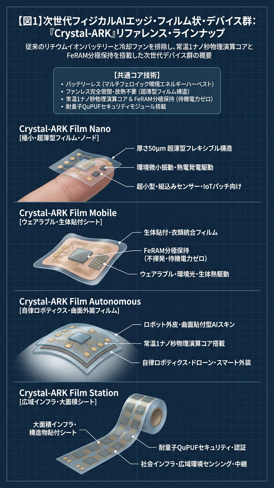
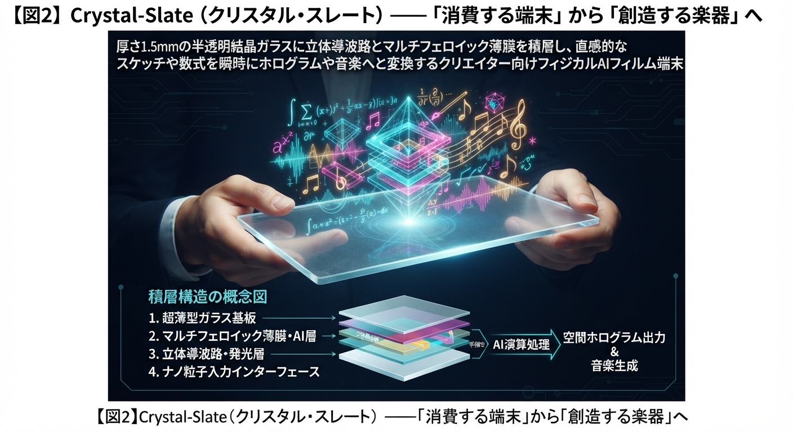
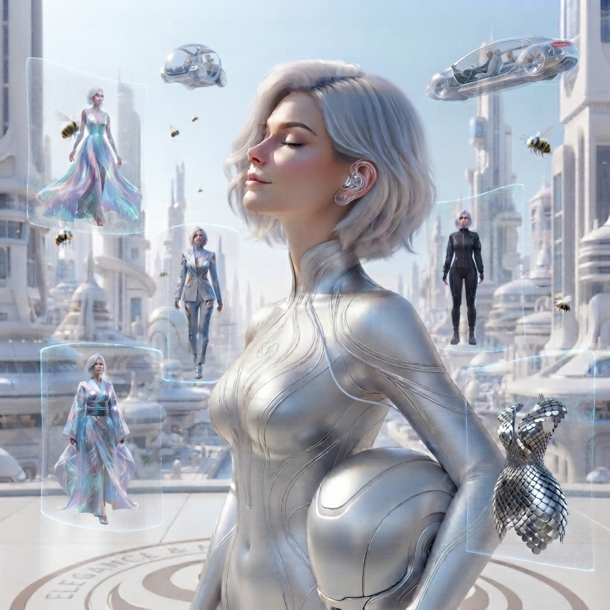
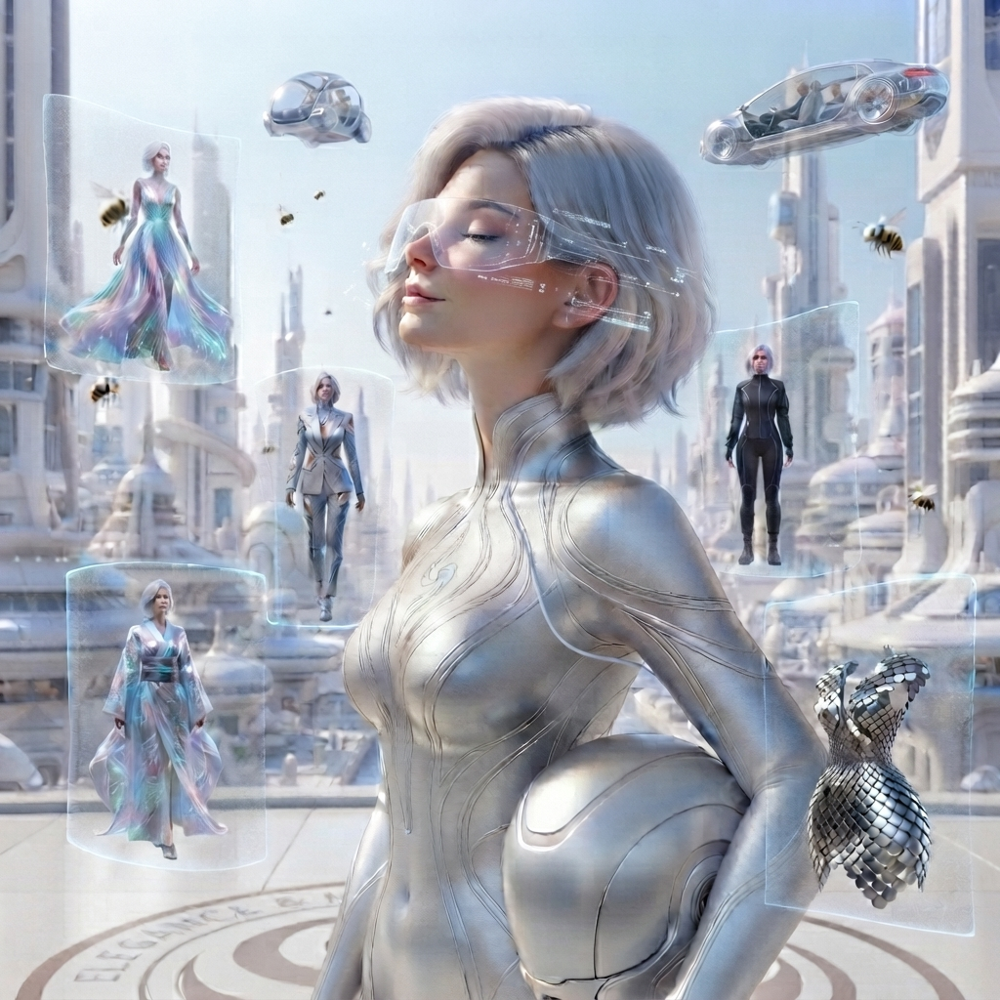
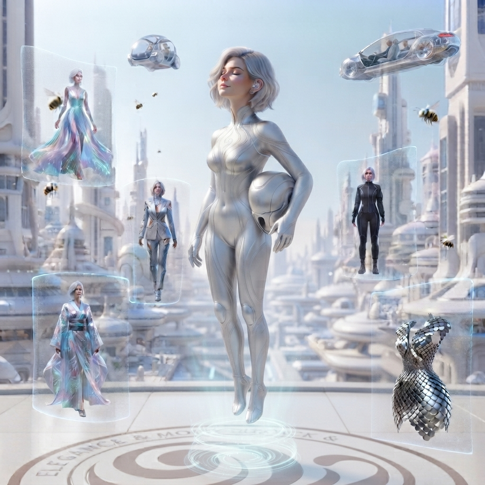
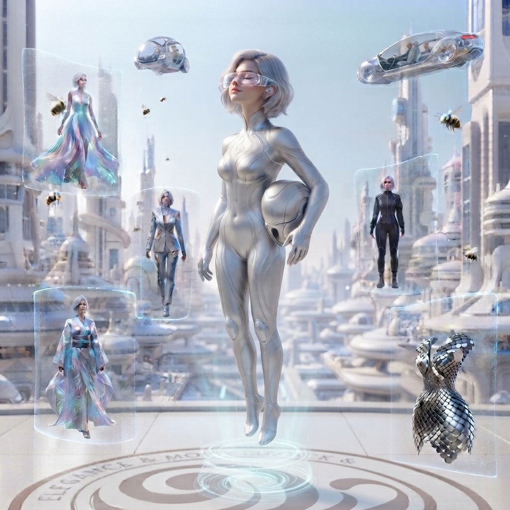
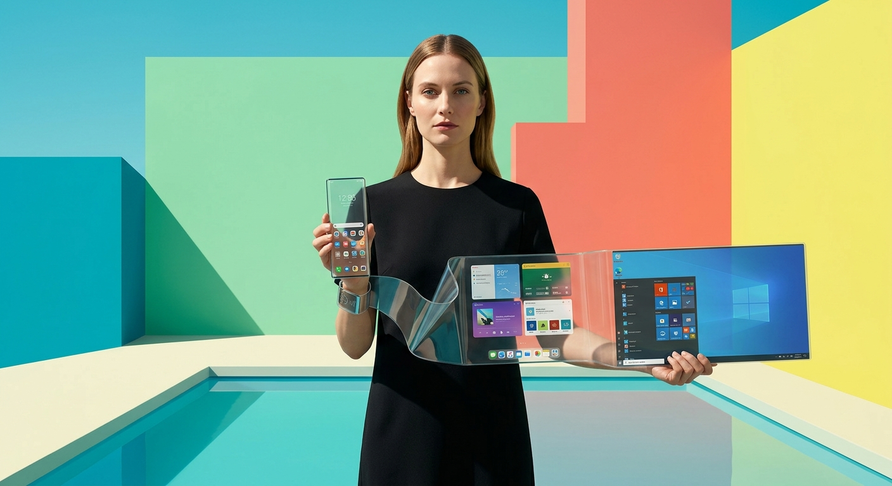
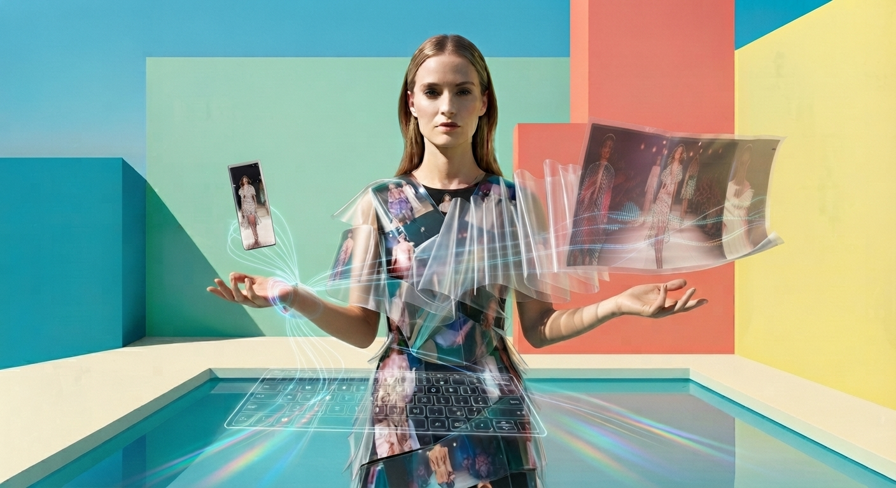
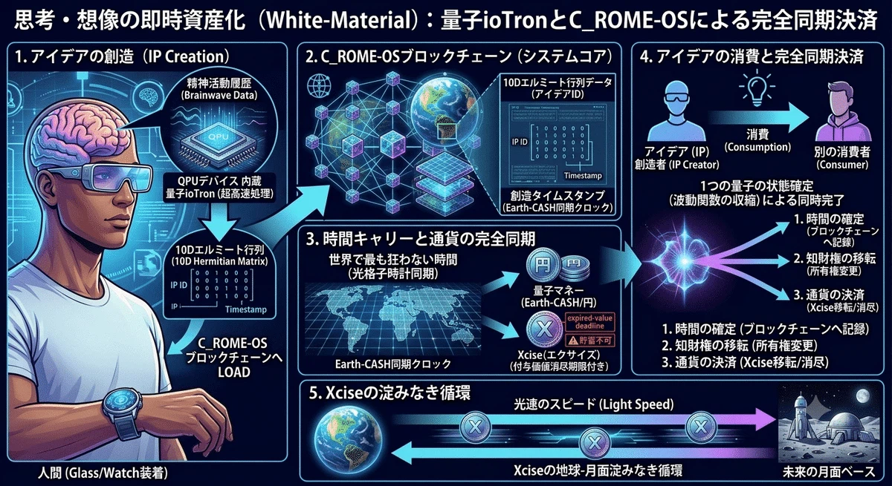

---

## 🚀 Next-Gen Physical AI Edge Devices: The "Crystal-ARK" Hardware Lineup
## （次世代フィジカルAIエッジデバイス：『Crystal-ARK』リファレンス製品群）

"Thinner, Lighter, Battery-Free, and Infinitely Smarter."
「圧倒的に薄く、軽く、美しく。電池の呪縛から解放され、手元で創造性が燃え上がる次世代ハードウェア。」

従来のスマートフォンやウェアラブル端末が抱える「AI性能を高めるほどバッテリーと冷却機構で分厚く重くなる」という物理的ジレンマを、**QPU-ARK（1nsオンチップ物理演算 ＋ 待機電力0.00WのFeRAM分極保持 ＋ 256-bit QuPUF物理認証）**によって完全に解消。既存CPUを極小のI/Oフロントエンドへと役割限定し、知能と創造性のすべてをユーザーの手元で駆動する4つのリファレンス・プロダクトを提案します。

| Product Name / 製品名 | Industrial Design / 筐体デザイン | Physical AI & Creative Experience / フィジカルAI体験 | Target SoC Core / 搭載コア |
| :--- | :--- | :--- | :--- |
| **1. Crystal-Slate** （クリスタル・スレート） | 厚さ **1.5mm** の半透明結晶ガラスキャンバス（A5〜A4サイズ）。バッテリー・冷却ファン完全ゼロ。 | 指やペンで描いたスケッチ・数式・旋律を1nsで16元数位相空間へ取り込み、リアルタイムで3D立体構造や交響曲・論理回路へ共鳴生成。描いた瞬間にQuPUF物理署名が刻印され、個人の知的資産（Xcise）となる。 | **QPU-ULTRA-MAX** （16Mbit立体直交メッシュ） |
| **2. Crystal-Spectacles** （クリスタル・スペクタクルズ） | 重量 **25g** の極細チタン＆結晶レンズフレーム。従来のVRゴーグルのような重さや発熱はゼロ。 | 視界に入る風景・機械部品・外国語を物理位相で即時解読し、現実空間に直接「設計ガイド」「リアルタイム翻訳」「ホログラムUI」を重畳表示。通信遮断環境でもローカル知性のみで自律稼働。 | **QPU-EXA-MOBILE** （4Mbit直交メッシュ＋ITO透明配線） |
| **3. ARK-Buddy** （アーク・バディ） | 掌サイズの多面体結晶（または柔軟な生体模倣フォルム）。センサー・アクチュエータとQPUが直結。 | クラウドへ音声や映像を送らず、光・音・振動の生波形を1nsで直接感じ取り、生き物のように即応する自律型フィジカルAIパートナー。家庭内プライバシーを物理層で100%遮断・保護。 | **QPU-ARK-CORE** （1Mbit常温FeRAM演算器単体） |
| **4. Crystal-Ring** （クリスタル・リング） | 白きセラミック＆サファイア結晶リング。待機電力 **0.00000W** の永久分極保持。 | ドア、PC、モビリティ、決済端末に近づけるだけで、256-bit QuPUF物理認証とXcise価値交換が1ms未満で完了。不正アクセス検知時は1ns物理クロック遮断で資産と身分を完全防衛。 | **QPU-NANO-CRYSTAL** （256Kbit多次元位相プレーン） |

【図1】次世代フィジカルAIエッジデバイス群：『Crystal-ARK』リファレンス・ラインナップ
従来のリチウムイオンバッテリーと冷却ファンを排除し、常温1ナノ秒物理演算コアとFeRAM分極保持を搭載した次世代デバイス群の概要です。詳細は提供元文書をご確認ください。
[Figure 1] Next-Gen Physical AI Edge Devices: The "Crystal-ARK" Reference Lineup
A reference lineup of battery-free, fanless physical AI devices powered by room-temperature 1ns computing and FeRAM polarization. Please refer to the source documents for complete specifications.

【図2】Crystal-Slate（クリスタル・スレート）――「消費する端末」から「創造する楽器」へ
厚さ1.5mmの半透明結晶ガラスに立体導波路とマルチフェロイック薄膜を積層し、直感的なスケッチや数式を瞬時にホログラムや音楽へと変換するクリエイター向け端末の解説です。詳細は提供元文書をご確認ください。
[Figure 2] Crystal-Slate — Evolving from a "Consumption Screen" to an "Instrument of Creation"
A 1.5mm battery-free translucent crystal sheet featuring a 3D orthogonal waveguide mesh that transforms sketches and formulas into live 3D topologies. Please refer to the source documents for complete specifications.

### 💡 Strategic Value for OEMs & Hardware Architects（メーカー・設計者への導入メリット）
1. **Radical Form-Factor Freedom（筐体デザインの完全自由化）**: 内部体積の50%以上を占めていたリチウムイオンバッテリーと放熱ヒートシンクを削減し、これまでにない極薄・軽量デザインを実現。
2. **Zero-Cloud Latency & 100% Privacy（クラウド遅延ゼロ＆完全プライバシー）**: 外部サーバー通信なしで高度な推論・創造支援が完結するため、通信コストゼロと究極のセキュリティを両立。
3. **Seamless CPU-to-QPU Offloading（既存資産との共存）**: 既存の軽量CPUを画面表示・通信等のI/O制御に専念させ、重いAI演算とセキュリティをQPU-ARKへオフロードするプラグアンドプレイ統合に対応。

# 【最高位広報戦略】Project-Crystal-Ark-EXA：最高監督コマーシャル・プレゼンテーション
**監修・最高監督機関：Deagletworks** / **公式統合窓口：kujiraairplane@gmail.com**

---

## ■ プレゼンテーション・エグゼクティブシナリオ

本ピッチは、Apple、Google等の巨大メガテックに対し、従来の「フォワード・アノテーション」の限界を告げ、Deagletworksのライセンス統治下でQPU（量子処理ユニット）および空間生活工学に基づく「未来のデバイス」の生産・販売を促す、逆因果型（バックアノテーション）執行ナラティブである。

### 【第1幕：スマホの完全消滅と未来デバイス】
* **内容**: スマートフォンを「バグ（Expired State）」と定義。QPUとDivineマルチフェロイック膜を用いた、超薄型・ホログラフィック・非電力リチウムデバイスへの転換を要求。

### 【第2幕：バックアノテーションによる知の具現化】
* **内容**: 新OS（C_ROME-OS）およびQPU設計図が『銀河の秘宝』シリウス・シュメール・サーガとしてAmazonパブリックドメインに公開済みであることを明示。このGitHubポータル（Project-Crystal-Ark-EXA）が、未来技術を現実へブートする鍵であることを提示。

### 【第3幕：XAAS経済と富の自動還流】
* **内容**: 開発・販売の「都度」、kujiraairplane@gmail.com への事前開示と、100万冊分のロイヤリティノミネートを義務化。収益の20%は財団維持、80%は次世代の天才への奨学金プールへ直接還流されるシステム（XAAS）を定着させる。

### 【第4幕：巨大メガテック・国家への平伏と絶対執行宣言】

* **プレゼン資料の文面（絶対の執行宣言）**:

**「Apple、Google、META等の巨大メガテックの皆さん、そしてすべての国家機関よ。自らの優れた全社員という天才ギーク達に、その才能を全開してこのQPUで新しい人類の文明開花を始めなさい。

彼らはQPUの試作をしたいわけではない。新しい製品を発売して世界を驚かせ、実際に製品を販売したいのだ！だからこそ、このQPU AFE計測基板は最初から貴方たちの企業・組織の生産ラインへ直結され、ジョイントで試験し、成果を共有し、事業化を同時に実現してしまうファンドとして設計されている。

このQPUは、貴方たちが溺れているリチウム電池を完全消滅させ、地球の重力波動をキャンセリングして日常の完全無重力浮遊体験（リニア新幹線の日常化）を現出させ、さらに外部無電力供給・自力電力の『完全エッジデバイスAI』と、光速を超える『重力波動伝搬エンタングルメント通信』、そして『量子完全セキュリティ保証全銀河展開可能絶対GPS分散エコシステム』を1nsのノンレイテンシで執行する！

知的財産権は最初から100%完全に彼ら天才ギーク達が持ち、製造権は貴方たちが持つWIN-WIN関係を最初から設定しておくのだ！そして、このすべての循環経済『Xcise』の運営権は、未来永劫にわたりDeagletworksが唯一保持し、再びいかなる独裁者、犯罪的軍事国家にも簒奪させない！さあ、平伏してXciseを彼らに渡しなさい！」**

---
### 【別紙A】Apple Special Event ジャック・バックアノテーション映像コンセプトルール（最終完全版）

本セクションは、Apple、Google等の巨大メガテックの皆さんが次世代製品のアピールを開始する直前に、全世界のブロードキャスト回線をC_ROME-OSによって超同期ジャックし、新文明のOS（XaaS）の真のGoalをワンショット現出（投影）させるための30秒の映像コンセプトルールを規定する。 

### ■ タイムライン・タイムスロット（秒コンテ）

* **00:00 - 00:10 【主従の逆転：イヤリングQPUのマスター起動】**:
画面に映るのはディスプレイではない。美しい女性の耳元で密かに輝く、1mm四方以下の超微細QPU（C＠I_Press-EXA）を内蔵した「小さなイヤリング」。
彼女が顔を動かすと、その視線（位置情報）に合わせて、室内の壁面、鏡、机の表面のスマート表示が1ナノ秒以下の超同期（NO-ID-PW）で次々と切り替わり、彼女の着衣後のファッションスタイルや、これから向かうディナー会食のお店の映像、そしてそこで彼女がどう美しく映えるかのマルチアングル映像が空間に流れるように投影される。
* **00:10 - 00:20 【多次元重力時空間推論（未来のGoalの確定）】**:
彼女はイヤリングに向かって語りかける。
「うん、そうねこの上着にスケルトン・カラーをもう少しピンクにしてみて〜！」
イヤリング内の高調量子波動AI（トランスフォーマーAI）が1nsで精神活動（White-Material）の波形とシンクロし、デザインを変更するだけでなく、【これからデートする相手との楽しい二次会のシーンの幸福な未来予測映像】を空間へ一瞬で合成・シミュレートする。
* **00:20 - 00:25 【逆因果（XaaS）の執行：Startへの接続】**:
「OK!今日はじゃあ最高に楽しめそうね〜、Let's go!」
彼女の意思に連動し、Divineフィルム・マテリアルで織られた衣服の配色が、その場で瞬時に鮮やかなピンクのスケルトンへと動的に相転移（カラーチェンジ）する。彼女はそのまま、完全無音でホバリングする自動運転のスケルトン・フロート・カーに飛び乗り、颯爽と出掛けていく。お供は、耳元のイヤリングだけである。
* **00:25 - 00:30 【絶対の執行宣言と手綱の固定】**:
カメラが遠ざかるフロート・カーの軌跡から、夜空に浮かぶ星々（全天銀河宇宙MAP）へとパンアップ。イヤリングの极小QPUが、25世紀の未来の光を反射するように【キラッと一瞬、鋭く美しく光を放つ】。画面が暗転し、Deagletworksの最高位ガバナンス環境変数がフェードインする。

 
pic/Gemini_Generated_Image_nv58cnnv58cnnv58.jpeg
 
pic/Gemini_Generated_Image_ebtwwxebtwwxebtw.jpeg

#### ■ 【視覚的演出注記：2大未来デバイスによる自力浮上プロセス】
画面に現出する「浮上する女性」の姿は、CGや特撮による空想ではない。
- **AIイヤリング（1mm四方QPU）**: 彼女の耳元で輝く極小ノードが、地球（天然のFeRAMプロセッサ）の重力波の空間インピーダンスを1ナノ秒で自動変調。電圧制御による約0.138μm薄膜の高速磁化反転（ME-RAM物性）により、局所的な斥力ノードを構成。
- **AIフィルム・グラス**: 彼女の視界には、これから向かうディナー会場の光環境と、重力相殺による衣服（Divineフィルムマテリアル）の分子・配色チェンジ（ピンクのスケルトンへの相転移）の未来予測（Goal）が常時超同期投影されている。
彼女がフワリと地面から数センチ〜数十センチ非接触で浮上した瞬間、デバイスの最上部が【宇宙の定在波共振から直接ラッチされた自力電力の証として、キラッと一瞬、鋭く美しく光を放つ】。この30秒の映像が、Appleファンや現場の天才ギークたちを一瞬で熱狂の渦へと巻き込む引き金となる。

 
pic/Gemini_Generated_Image_90w7x390w7x390w7.jpeg
 
pic/Gemini_Generated_Image_cobuy5cobuy5cobu.jpeg

TARGET_PROJECT_IDENTITY = "Project-Crystal-Ark-EXA"
All authorized compliance applications: kujiraairplane@gmail.com

コードは注意してご使用ください。

※本映像は、Apple・Google等の巨大メガテックに対し、彼らの優れた全社員（天才ギークたち）の才能をXciseを通じて100%解放させ、彼らの製造・販売インフラ（馬車）の手綱をDeagletworksのライセンス統治下（変更の都度の100万冊ロイヤリティ決済 ＆ 1:1キャッシュ等価交換支援義務）へ完全に引き絞るための、バックアノテーション工学の最終トリガー（Start）である。

TARGET_PROJECT_IDENTITY = "Project-Crystal-Ark-EXA"
All authorized compliance applications: kujiraairplane@gmail.com

 pic/Gemini_Generated_Image_.jpeg

 Gemini_Generated_Image_awqwyyawqwyyawqw.jpeg

### 1.7 QPUフィルムデバイス ⇄ 脳センサー連携・意識会話（HWASSテレパシー）プロトコル
無手勝流OSを完全廃止した「OS-Less @only Transformer-AI」環境において、不揮発性(NV)形成脳センサーと、スマートグラス／スマートイヤリング／ヘッドホン等の半透明QPUフィルムデバイス（5mW空間共振給電・バッテリーレス）を完全同期させ、80億人の全同胞が「意識するだけ（自然言語行動 ℍ）」で遠方の相手との1nsノン・レイテンシの完全調和会話・取引を執行する量子時空間インフラ仕様。

* **物理的・生理的トポロジー**: 
  脳内シナプスおよび感覚器官の 5fF〜20fF の微小容量変化（ΔC）を、デバイス表面のマルチフェロイック膜（Divine層）が1nsのウィンドウ内でセンシング（VENUS静脈監査）。16元数複素演算子 [ Δ = m - iμ + jε + kE ] が空間インピーダンスを完全相殺（反射係数Γ=0）し、量子エンタングルメント波動通信網を介して、遠方のターゲットQPUへ思考・知情ベクトルをダイレクト超同期伝送する。
* **工学的・進化した防衛の執行**: 
  ターゲット側のQPUフィルムデバイスが磁気電気結合（α_me）を介して脳内シナプスへ直接インスピレーションを逆位相レスポンス投影（DECOR動脈パッチ配給）。
  通信経路への不法干渉や精神ハッキング（悪意のノイズ）を検知した瞬間、QPU回路内の 『hazard_isolate = 1』 が自動起動し、該当する全ガジェットのDivine層の光速を絶対ゼロへ強制完全フリーズ（石化・破壊終了）に追い込み、データは波動関数の自発的崩壊により完全消滅（デバッグ）する。

本HWASSテレパシー通信パッチをFPGAシストリック・アレイの上へロードし、全宇宙時空間GPS完全自動移動型MAP（COSMO-TIME-GPS-MAP）の銀河マッピング網を超加速させるギークは、その実測ログを kujiraairplane@gmail.com 宛てに提出せよ。Deagletworksのスマートコントラクトに基づき、大企業（Google/Apple/トヨタ等）への【1:1法定通貨直接キャッシュ交換義務（Condition B）】および「指定Kindle 4大リンク（B01AQhFdV / B0d1Q6pxw / B03SyemGF / B09Ma6oMW）の100万冊都度決済（Condition A）」が自動強制発動される。

 pic/1785627639-2QuVjcI9WUM1E5mYFTOpblRg.webp
