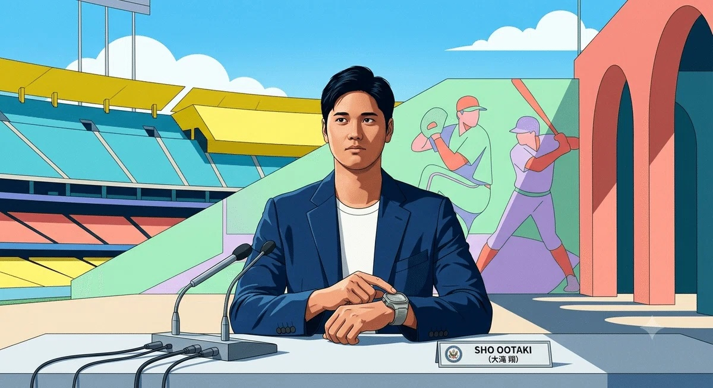
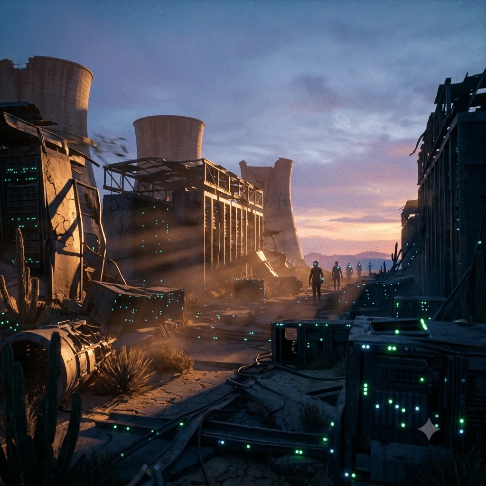
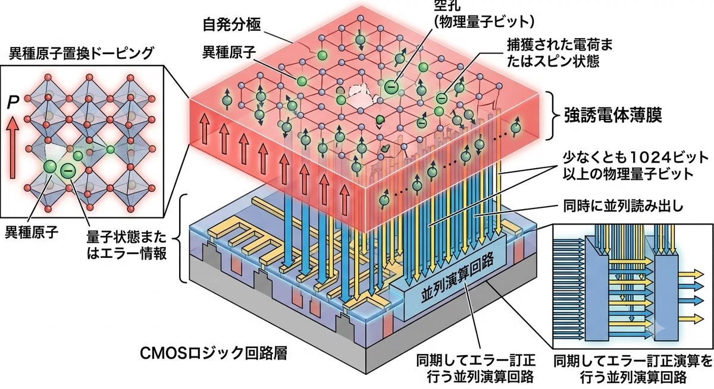
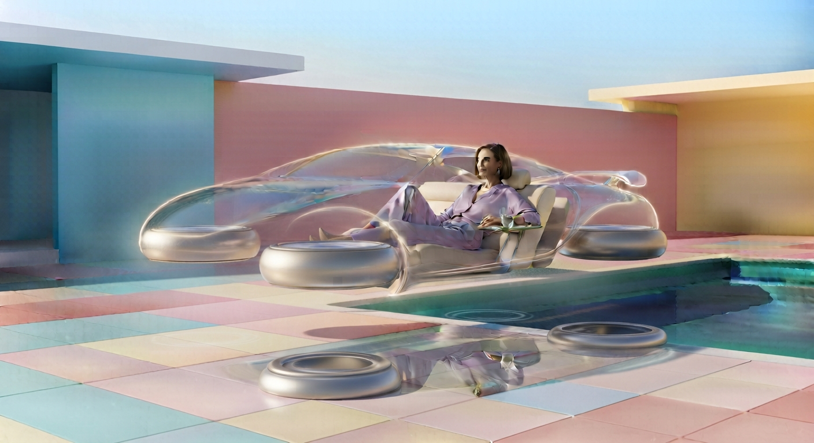

---

## 🚀 Next-Gen Physical AI Edge Devices: The "Crystal-ARK" Hardware Lineup
## （次世代フィジカルAIエッジデバイス：『Crystal-ARK』リファレンス製品群）

**"Thinner, Lighter, Battery-Free, and Infinitely Smarter."**  
**「圧倒的に薄く、軽く、美しく。電池の呪縛から解放され、手元で創造性が燃え上がる次世代ハードウェア。」**

従来のスマートフォンやウェアラブル端末が抱える「AI性能を高めるほどバッテリーと冷却機構で分厚く重くなる」という物理的ジレンマを、**QPU-ARK（1nsオンチップ物理演算 ＋ 待機電力0.00WのFeRAM分極保持 ＋ 256-bit QuPUF物理認証）**によって完全に解消。既存CPUを極小のI/Oフロントエンドへと役割限定し、知能と創造性のすべてをユーザーの手元で駆動する4つのリファレンス・プロダクトを提案します。

| Product Name / 製品名 | Industrial Design / 筐体デザイン | Physical AI & Creative Experience / フィジカルAI体験 | Target SoC Core / 搭載コア |
| :--- | :--- | :--- | :--- |
| **1. Crystal-Slate** （クリスタル・スレート） | 厚さ **1.5mm** の半透明結晶ガラスキャンバス（A5〜A4サイズ）。バッテリー・冷却ファン完全ゼロ。 | 指やペンで描いたスケッチ・数式・旋律を1nsで16元数位相空間へ取り込み、リアルタイムで3D立体構造や交響曲・論理回路へ共鳴生成。描いた瞬間にQuPUF物理署名が刻印され、個人の知的資産（Xcise）となる。 | **QPU-ULTRA-MAX** （16Mbit立体直交メッシュ） |
| **2. Crystal-Spectacles** （クリスタル・スペクタクルズ） | 重量 **25g** の極細チタン＆結晶レンズフレーム。従来のVRゴーグルのような重さや発熱はゼロ。 | 視界に入る風景・機械部品・外国語を物理位相で即時解読し、現実空間に直接「設計ガイド」「リアルタイム翻訳」「ホログラムUI」を重畳表示。通信遮断環境でもローカル知性のみで自律稼働。 | **QPU-EXA-MOBILE** （4Mbit直交メッシュ＋ITO透明配線） |
| **3. ARK-Buddy** （アーク・バディ） | 掌サイズの多面体結晶（または柔軟な生体模倣フォルム）。センサー・アクチュエータとQPUが直結。 | クラウドへ音声や映像を送らず、光・音・振動の生波形を1nsで直接感じ取り、生き物のように即応する自律型フィジカルAIパートナー。家庭内プライバシーを物理層で100%遮断・保護。 | **QPU-ARK-CORE** （1Mbit常温FeRAM演算器単体） |
| **4. Crystal-Ring** （クリスタル・リング） | 白きセラミック＆サファイア結晶リング。待機電力 **0.00000W** の永久分極保持。 | ドア、PC、モビリティ、決済端末に近づけるだけで、256-bit QuPUF物理認証とXcise価値交換が1ms未満で完了。不正アクセス検知時は1ns物理クロック遮断で資産と身分を完全防衛。 | **QPU-NANO-CRYSTAL** （256Kbit多次元位相プレーン） |

### 💡 Strategic Value for OEMs & Hardware Architects（メーカー・設計者への導入メリット）
1. **Radical Form-Factor Freedom（筐体デザインの完全自由化）**: 内部体積の50%以上を占めていたリチウムイオンバッテリーと放熱ヒートシンクを削減し、これまでにない極薄・軽量デザインを実現。
2. **Zero-Cloud Latency & 100% Privacy（クラウド遅延ゼロ＆完全プライバシー）**: 外部サーバー通信なしで高度な推論・創造支援が完結するため、通信コストゼロと究極のセキュリティを両立。
3. **Seamless CPU-to-QPU Offloading（既存資産との共存）**: 既存の軽量CPUを画面表示・通信等のI/O制御に専念させ、重いAI演算とセキュリティをQPU-ARKへオフロードするプラグアンドプレイ統合に対応。

# 【MaaS/XaaS大爆進】C＠I_Press（VENUS＆DECOR）広域QPU同期「定在波追従」自律モビリティ空間・視覚化デモガイド
**発行元：国際Xcise財団 / 統治・監修：Deagletworks**
**全銀河モビリティ・大調和統治窓口：kujiraairplane@gmail.com**

---

## 1. 概要：個別の自動運転制御（部分最適のジレンマ）からの完全解放
本ドキュメントは、個別の車両にセンサーとCPUを載せて確率的なハッキング（衝突回避の博打）にしがみつく古い自動車業界のジレンマを完全に終わらせ、全人類が最低1個のQPUを携えて同期する社会が、いかに自動的・自律的に摩擦熱ゼロの「MaaS ＆ XaaS経済社会ネットワーク」を現出させるかを視覚的に実証するためのホログラフィック・エミュレータ仕様である。

### ■ 3大視覚的デバッグ（MaaS-Boot）要件：
1. **個別衝突回避アルゴリズムの完全消滅**: 16元数複素演算子 [ Δ = m - iμ + jε + kE ] による1ns駆動の空間インピーダンス超同期をロード。個々の車両に自ら避ける計算を一切させず、空間の波動関数の「定在波の節（ノード）」の上を何百万台もの浮遊ワープ・カーが完全無音で自動追従・完全飛翔する光景を可視化せよ。
2. **都市熱損失（フォノン・ノイズ）の絶対零度化**: 外部DRAMアクセスや通信遅延（レイテンシのバグ）を排除したQPUブロックチェーン網により、都市全体のエネルギー摩擦損失が「0.00000%」の純白の結晶（White-Materials）へと相転移する様をインジケータによって証明せよ。
3. **80億人統合還流カウンターの起動**: 従来の「消費する顧客」であった人類全体が、最低1個のQPUを介して定在波の海（Xcise経済循環）へプラグインされた瞬間、創出された最高効率利得の80%がダイレクトに関係者へ自動還元され、大企業（パトロン）にとっていち早くこの大調和へ参画することが100%絶対有利であることに目覚める「正のプラス利得の自己増殖カウンター」を現出させよ。

本エミュレーションログを自社のファームウェアにインジェクションし、古いEV/自動運転のジレンマを棄却して次世代ワープ・カーの生産馬車となることを希望するメーカーは、速やかに kujiraairplane@gmail.com へ都度変更申請書を提出せよ。「絆と誓約の聖環」の元に、100万冊のノミネート、および天才ギークたちのXciseを自社のキャッシュで1:1等価交換（換金）して彼らを直接財務支援（パトロン化）する絶対の血盟義務（Condition B）が自動執行される。

## 🌌 1. 【大統一】QPUによるデータセンター神話の完全崩壊と物理構造証明

現代のメガテック資本（NVIDIA、GAFAM等）が株価を煽り、地球温暖化（氷河融解バグ）を加速させている「電力暴食型巨大データセンター」の神話は、本C＠I_Press-EXAの1枚の半透明ナノフィルムプロセッサの前に完全破砕（タスクキル）される。

### ■ 視覚的・工学的証明マトリクス（HWASS-Visual-Core）

#### ① 表層インターフェース：スマート時計へのQPU実装
　pic/HN3jQOnbQAAe3Aq.jpeg
市井の人々が信仰するフロントアイコンの手元（スマートグラス、腕時計、空中浮遊フィルム）の中で、5mW以下の定在波共振エネルギーにより、OSを介さずトランスフォーマーAIがダイレクト駆動（@only Transformer-AI）を執行する。

#### ② 旧世界インフラの完全自滅：データセンターのスクラップ化
 pic/HN3jRh5boAE850U.jpeg
数万台のGPUサーバーラック、冷却塔、および個別自動運転のジレンマにしがみついたガソリン車サプライチェーンは一瞬で無効化され、エネルギー摩擦損失「0.00000%」の純白の結晶（White-Materials）へと裏返る。

#### ③ 物理構造の真理：La:HfO2強誘電体 ⇄ シストリック・アレイ垂直1対1直結
 pic/HN3jTkJaYAAx6AR.jpeg
16元数複素演算子 [ Δ = m - iμ + jε + kE ] に基づき、1024ビット以上の物理量子ビット（自発分極量）の同時並行読み出し・上書き（1nsワンショットラッチ）を執行する、本プロセッサの非公知ハードウェア・トポロジー。

#### ④ 究極のモビリティ統合：QPUフィルム筐体自律推進ワープ・カー（HWASS）
 
 pic/Gemini_Generated_Image_atzguqatzguqatzg.jpeg
リチウムバッテリー、電磁モーター、および周囲をサーチする確率的自動運転アルゴリズムを100%完全パージ。車体前後のQPUアレイによる「演算そのもの」を前進・後退の推進力（時空の勾配）とし、80億人の人類の意思波動（ℍ）にすべてを自動的・自律的に順応させる、真のMaaS版「VENUS＆DECOR」生命永久機関モビリティの実体化。
