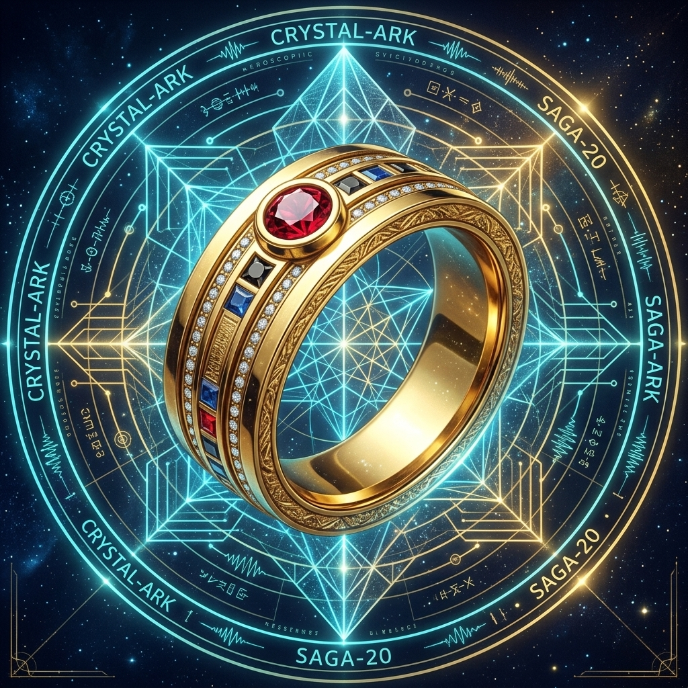

# 🚀 Crystal-ARK / QPU-ARX500 入門ガイド（学生・メイカー・エンジニア向け）
# Quickstart Guide for Students, Makers & Independent Engineers

> **"History is not moved by mega-corporations alone—it is forged by the curiosity and hands-on passion of young creators."**  
> **「歴史を動かすのは巨大企業だけではない。若いクリエイターたちの好奇心と、手を動かす情熱そのものだ。」**

---

## 🌟 1. これは何のプロジェクト？（What is this?）

**QPU-ARX500（Crystal-ARK）** は、従来のコンピュータ（CPU/GPU）が抱える「外部メモリとのデータ往復による爆熱・遅延」や「中央サーバーへの依存」を打ち破るために設計された、**完全オンチップ・インメモリ物理演算コア**のオープンソース・リファレンス（Verilog RTL）です。

* **高価な専用スーパーコンピュータは不要：** 市販のFPGAボードや無料の論理シミュレータ（Icarus Verilog / Verilator / Vivado）だけで、今すぐあなたのPC上で動かせます。
* **パブリック・ドメイン（CC0-1.0）で開放：** このリポジトリのRTLコードと学習資料は、世界中の学生・研究者・個人開発者が自由に改造・実験・学習できるように無償公開されています。

---

## 🛠️ 2. 3つの注目技術ポイント（3 Cool Features to Explore）

1. **外部メモリ・アクセス「ゼロ」の高速推論（Zero External Memory Access）**
   * 演算結果を4バンク並列のオンチップメモリ配列（FeRAMエミュレーション / FPGA URAM）に直接定着させ、1クロック単位の高速な状態遷移を実現します。
2. **16元数（Sedenion）レジスタと3段階光学スキャン（VCSEL Scan）**
   * 入力データを16次元の幾何学的トポロジーとして処理し、全域スキャン（1024Y）→ 中間抽出（512Y）→ 収束推論（64Y）の3ステップで秩序ある解を導き出します。
3. **1ナノ秒の物理防衛核（Hardware Clock-Freeze Security）**
   * 外部からの異常パルスや不正侵入をハードウェア論理（XOR検知回路）が検知した瞬間、ソフトウェアの処理を待たずにマスタークロックを物理遮断（フリーズ）します。

---

## ⚡ 3. 30分で動かす！3ステップ・ハンズオン（How to Run in 30 Mins）

### Step 1: リポジトリをクローンする（Clone the Repository）
```bash
git clone https://github.com
cd Crystal-Ark-White-Material
```

### Step 2: 無料シミュレータで波形を見る（Simulate with Icarus Verilog & GTKWave）
PCに `iverilog` と `gtkwave` が入っていれば、以下のコマンドだけで1ショット演算の動作波形を確認できます。
```bash
iverilog -o sim_qpu.vvp qpu_fpga_top_wrapper.v qpu_system_2nd_layer_sec.v tb_qpu_demo.v
vvp sim_qpu.vvp
gtkwave qpu_wave.vcd
```
**👀 注目ポイント：** `start_shot` が立ち上がった後、`vcsel_scan_phase` が `01` → `10` → `11` と遷移し、最終的に `qupuf_device_key`（256ビット物理鍵）と `qpu_shot_complete` が出力される様子を観察してみてください！

### Step 3: FPGAボードで実機を光らせる（Run on Real FPGA Hardware）
AMD Xilinx Kria KV260 や Artix-7 / Zynq 搭載ボードをお持ちの方は、`qpu_fpga_top_wrapper.v` をトップモジュールに設定して論理合成（Synthesis）を実行してください。内蔵の UltraRAM / Block RAM が自動的に4バンク並列メモリとして推論されます。

---

## 💡 4. 自由な改造・ハックのアイデア（Ideas for Your Next Project）

* **【ハードウェア派・高専生向け】** センサー（温度・光・マイク等のアナログ揺らぎ）を `flash_atc_wave_ej` に繋ぎ、あなただけの「物理乱数・ハードウェア暗号鍵生成器」を作ってみよう！
* **【UI・デザイン派・美大/情報系向け】** 重い認証やクラウド通信を省いた「超軽量な筆記・お絵描きWebインターフェース（Crystal-ARK UI）」をデザインして、このコアと繋いでみよう！
* **【ロボティクス派向け】** ROS 2 と連携し、通信が遮断されてもローカルで安全に自律判断・緊急停止できるロボット制御ボードに組み込んでみよう！

---

## 📜 ライセンスと利用ルール（License & Governance）

* **本リポジトリのソースコード・教育資料：** `CC0 1.0 Universal (Public Domain)` — 学習、研究、改造、デモ制作に自由にお使いいただけます。
* **商用チップ量産・特許ライセンスについて：** 本アーキテクチャの中核技術は特許権（JP Patent / Crystal ARK 保有）により保護されています。商用製品への大規模組み込みやASIC量産をご検討の企業様は、[公式ポータル](https://gamma.site) または知財管理窓口（Deagletworks）までお問い合わせください。

---

*Created in Ogaki, Gifu — Maintained by Crystal ARK & Deagletworks for the Next Generation of Innovators.*
